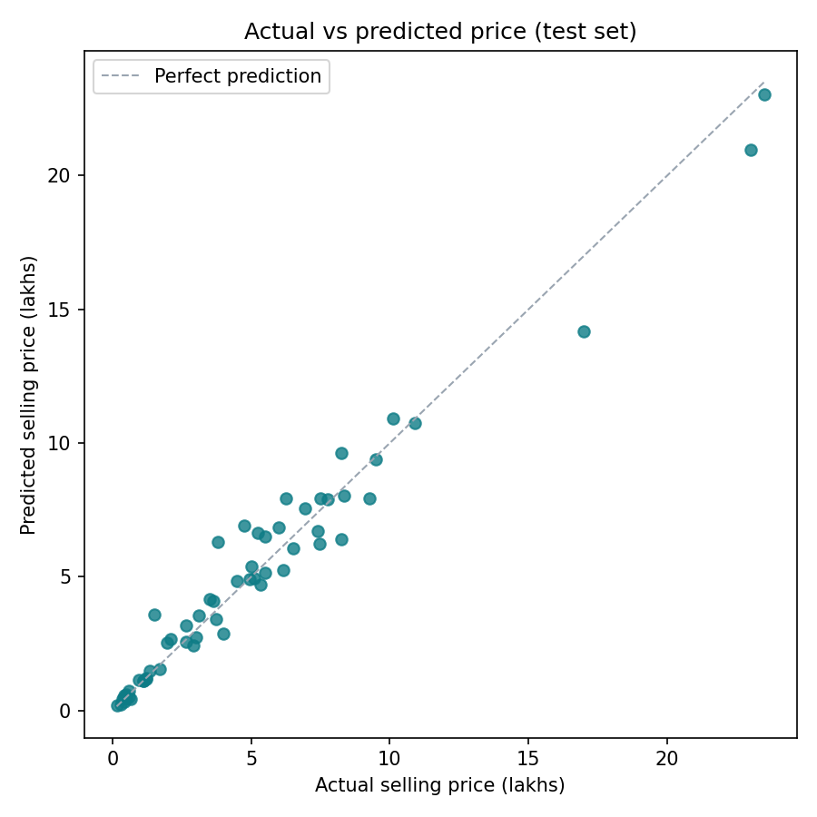
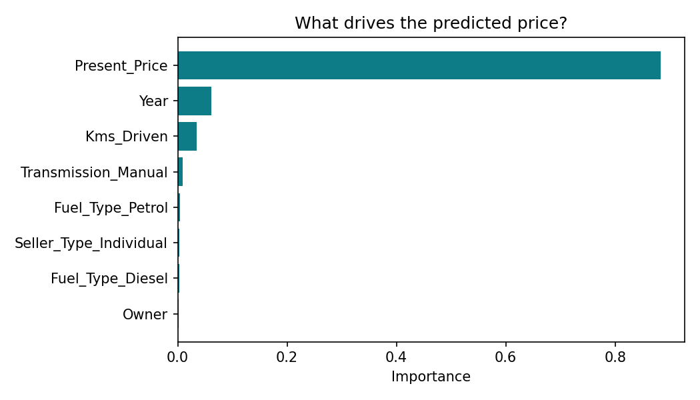
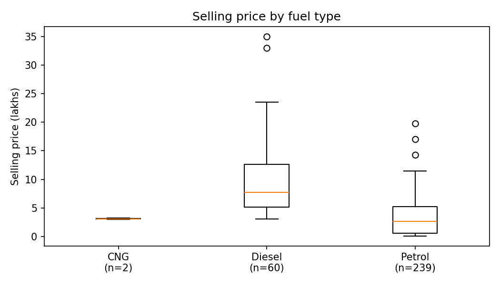
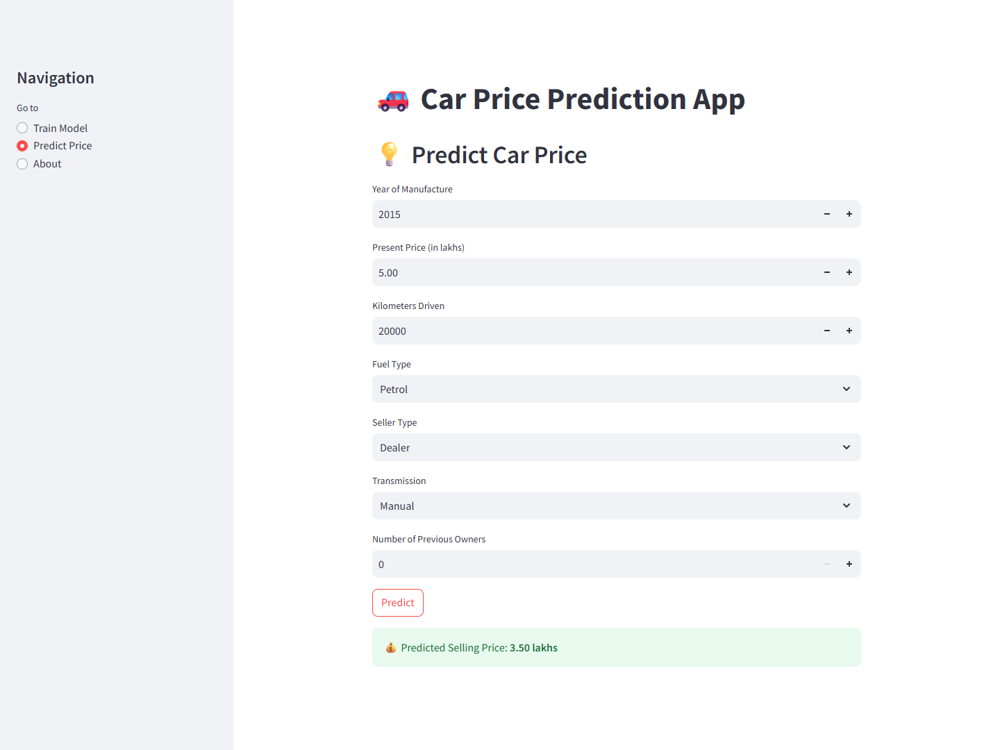

# 🚗 Used Car Price Prediction



Estimate a used car's selling price from its age, original price, mileage, fuel type, seller type and transmission, and find out which of those actually drive the price. A CodeAlpha data science project.

**Portfolio:** [syedahafsa135.github.io](https://syedahafsa135.github.io)

---

## Problem

A used-car dealer or private seller wants a fair asking price. **Which features of a car drive its resale value, and can we estimate a price from them reliably?**

## Data

- **Source:** used-car listings, in `data/car data.csv`
- **Size:** 301 cars, model years 2003–2018 (239 petrol, 60 diesel, 2 CNG)
- **Columns:** `Car_Name`, `Year`, `Selling_Price` (target, in lakhs), `Present_Price` (new price, in lakhs), `Driven_kms`, `Fuel_Type`, `Selling_type`, `Transmission`, `Owner`

## Method

1. Load the data, drop rows with missing values, and standardise two column names (`Driven_kms` → `Kms_Driven`, `Selling_type` → `Seller_Type`) so training and the app use the same names
2. Drop `Car_Name` and one-hot encode `Fuel_Type`, `Seller_Type` and `Transmission`
3. Split 80% for training and 20% for testing (`random_state=42`)
4. Train a **Random Forest Regressor** (100 trees)
5. Evaluate on the **test set only** with MAE, RMSE and R²
6. Save the model (`models/model.pkl`) and serve predictions in a **Streamlit** app

## Results

Scores on the 61 test cars (output of `python -m src.evaluate`):

| Metric (test set) | Value |
|---|---|
| MAE (lakhs) | 0.60 |
| MSE | 0.82 |
| RMSE (lakhs) | 0.91 |
| R² | 0.964 |

- **The model is accurate on unseen cars.** It explains 96.4% of the variation in price. The largest errors are on the few expensive cars.
- **A car's new price is the strongest driver** (importance 0.884), followed by year (0.062) and kilometres driven (0.034). Transmission, fuel type, seller type and owners each add less than 0.01.
- **Diesel cars sell for more than petrol cars in this data,** but fuel type barely registers in the model. The gap likely reflects which cars are diesel rather than the fuel itself. Only 2 cars are CNG, too few to conclude anything.





### The app

Enter a car's details and get a resale price estimate (screenshot of the app running locally).



## How to run

**Option A: Google Colab (nothing to install)**

```python
!git clone https://github.com/syedahafsa135/CodeAlpha_CarPricePrediction.git
%cd CodeAlpha_CarPricePrediction
!python -m src.train      # trains the model and prints test-set scores
!python -m src.evaluate   # prints scores + feature importance, saves charts to images/
```

**Option B: on your own computer**

```bash
git clone https://github.com/syedahafsa135/CodeAlpha_CarPricePrediction.git
cd CodeAlpha_CarPricePrediction
python -m venv venv
venv\Scripts\activate          # on Mac/Linux: source venv/bin/activate
pip install -r requirements.txt
python -m src.train
python -m src.evaluate
streamlit run app.py           # opens the prediction app in your browser
```

## Limitations

- 301 cars with few expensive ones: errors are largest at the high end, where the data is thinnest.
- Only 2 CNG cars, so nothing can be concluded about CNG.
- A single 80/20 split; cross-validation would give a steadier estimate.

## Project structure

```
├── app.py              # Streamlit app: train, predict, about
├── data/car data.csv
├── models/model.pkl    # saved Random Forest model
├── images/             # charts created by src/evaluate.py
└── src/
    ├── data.py         # load, clean, encode and split
    ├── train.py        # train, save and score the model
    ├── evaluate.py     # test-set scores, feature importance, charts
    └── predict.py      # predict the price of a new car
```

## Tech stack

Python · pandas · NumPy · scikit-learn · joblib · Matplotlib · Streamlit
